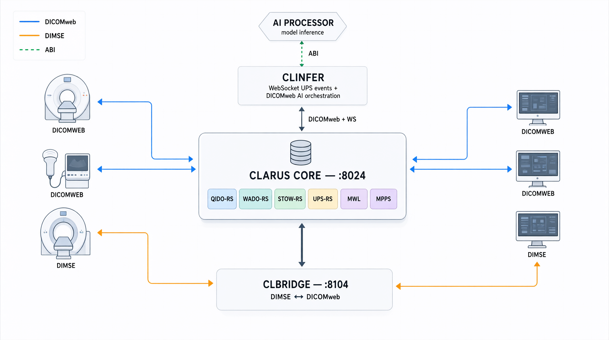

# Clarus PACS

> A vendor-neutral DICOMweb archive with a minimal core.

Clarus is a standalone DICOMweb archive (QIDO-RS, WADO-RS, STOW-RS,
UPS-RS, Storage Commitment, Worklist (MWL), MPPS). It conforms to
PS3.18 2026d and implements IHE AIW-I Rev 1.1, with conformance
statements per PS3.2. The core — `clarus` and `clinfer` — ships as
static binaries with no SQL database, no JVM, and no async runtime in
the core.[^1] `clbridge` is a Python sidecar: packaged as a
self-contained executable on Windows, a plain script on Linux.

## Quick Start

Download. Extract. Click and run.

The release package contains the complete suite of binaries: `clarus`,
`clbridge`, and `clinfer`. `clarus` ships built with `--features
transcode` — it provides full DICOMweb conformance on compressed
transfer syntaxes and viewer thumbnails, and it carries
[additional risks](docs/production-setup.md#transcode-build).

- Download the [release archive](https://github.com/clicker71/clarus-pacs/releases) for your platform from the Releases page.
- Extract the archive to any directory.
- Run the binaries directly — zero configuration required. Point a
  browser at the server's `/` — an inline mini-viewer (about 30 KB)
  answers in milliseconds, a visual ping that the archive is up.[^2]
- Or run the containers (no download):
  `docker run -p 8024:8024 ghcr.io/clicker71/clarus-pacs/clarus:latest`
  `docker run -p 8104:8104 -p 8105:8105 ghcr.io/clicker71/clarus-pacs/clbridge:latest`

  `latest` tracks the newest release. The running build names itself:
  the mini-viewer at `/` prints `clarus <version> (<commit>, <date>)`,
  and `/version` reports the same for scripts. Pin an exact version by
  replacing `latest` with a release tag (e.g. `0.3.0-beta`).

For system services, NVMe PLP storage tuning, and reverse-proxy setup,
see the [Production Deployment Guide](docs/production-setup.md). To
reach terminal velocity for your platform, use server-grade NVMe with
power-loss protection (PLP) and build with `--target-cpu=native`.

## Components

- **clarus** — core DICOMweb engine. Unicode-aware fuzzy patient
  search: `fuzzymatching=true`, Levenshtein-1 over an n-gram index,
  correct for any script (Cyrillic, CJK, Greek, Arabic, Katakana),
  O(candidates), zero heap in the hot path.
  [DICOMweb conformance statement](docs/dicomweb-conformance-statement.md)
- **clbridge** — universal DIMSE ↔ DICOMweb gateway.
  [DIMSE bridge conformance statement](docs/dimse-bridge-conformance-statement.md)
- **clinfer** — universal IHE AIW-I Task Performer.
  [IHE AIW-I conformance statement](docs/aiw-i-conformance-statement.md)

## Principles

1. **Everything is a file.** DICOM objects are stored in
   Content-Addressed Storage (CAS) as plain files. Indexes are B-trees
   and CBOR manifests.
2. **Data structures matter more than code.** The core is designed
   around the study manifest and the frame-chunk table.
3. **Trust the measurement, not the intuition.** Human intuition about
   performance is frequently wrong. Every optimisation is validated by
   Criterion benchmarks and the ap101 gate harness. If the numbers
   improve, the change is accepted — even when it contradicts
   conventional wisdom. If the numbers do not improve, the change is
   rejected — even when it "looks faster".
4. **The fastest code never executes.** The core delegates task
   scheduling to the OS kernel and TLS/C10k to Nginx.
5. **Simplicity takes work; complexity sells better.** No plugin
   system, no built-in UI, no database migrations.
6. **Controlling complexity is the essence of programming.** DIMSE is
   isolated in a separate process, never a module inside the core.
7. **Simplicity is when you understand the system.** The core is small
   enough to fit in one head.
8. **Do one thing and do it well; delegate the rest.** Clarus does only
   DICOMweb (QIDO-RS, WADO-RS, STOW-RS, UPS-RS, MWL, MPPS) and writes
   audit logs in ATNA/GOST format. TLS, C10k, dashboards, backups, and
   identity are delegated to the tools that already solve them better:
   Nginx, Prometheus/Grafana, the OS kernel, and the filesystem.

## Safety and Performance

Clarus achieves peak performance without pointer arithmetic, manual
memory management, or other unsafe hacks in the hot path. The unsafe
code is strictly limited to OS boundaries: syscalls, FFI, and
memory-mapped files. Every unsafe block is explicitly audited and
documented in [docs/unsafe-audit.md](docs/unsafe-audit.md).

This is a deliberate architectural choice: no hidden cost, no undefined
behaviour, no heisenbugs. The result is stable, predictable performance
bounded by the NVMe drive and the network, not by the CPU.

## Architecture

Unlike legacy PACS where DICOMweb is bolted onto a DIMSE core, Clarus
inverts the stack: DICOMweb is the core, and DIMSE is a removable
bridge.

**Stateless compute over shared storage.**

- **Clarus (core):** One binary. No SQL, no async runtime, no runtime
  dependencies. Synchronous thread-per-connection HTTP stack.
  Content-addressed storage, UPS-RS Task Manager.
- **clbridge (sidecar):** Stateless. Speaks standard DIMSE on one side
  and standard DICOMweb on the other. Scale by adding bridges. It
  preserves DIMSE-grade delivery guarantees over DICOMweb: accepted
  studies are buffered in an outbox, and the HTTP status from the core
  decides whether the modality gets an acknowledgement or a retryable
  DIMSE error (0xA700).
- **clinfer (sidecar):** Claims UPS-RS workitems, runs site-supplied
  models under a model-agnostic contract, and stores results back with
  STOW-RS.

Sidecars communicate with the core over standard protocols. They are
not plugins: no shared memory, no linked code. Replace, restart, or
scale them independently.

**Scale-out shape:** N bridges, one Clarus core, one shared CAS. The
bridge side scales with the number of bridges — the bridge is stateless
and deployable one per modality — and the shared STOW path is the cap.

## Verifiable Storage Commitment

Clarus uses Content-Addressed Storage (CAS) to eliminate database
drift.

- **The address is the content.** Incoming payloads are hashed with
  BLAKE3 and stored at a path derived from their cryptographic digest.
- **Cryptographic proof of durability.** The study manifest embeds the
  CAS frame-chunk table, proving the stored pixel data is intact
  (DICOM PS3.4 J.1.1).
- **Strict acknowledgement boundary.** 200 OK (and PS3.18 Section 13
  Storage Commitment) is returned only after fsync to disk and atomic
  manifest commit.

## AI pipeline (clinfer + ABI)

`clinfer` is a UPS-RS Task Performer (IHE AIW-I). It claims workitems
from Clarus, runs a site-supplied model script under a model-agnostic
contract, and stores results back with STOW-RS. Both Pull and Triggered
Pull workflows are supported; WebSocket Push is implemented and pending
external validation.

**Standard on the wire, simple on the desk.** Everything clinfer
exchanges with Clarus and the viewer is standard DICOMweb + UPS-RS. The
only non-standard part is the local model contract (`manifest.json` in,
`result.json` out) — no HTTP server for the integrator to run.

**Future-proof ABI.** When DICOM Supplement 251 (Application Request)
is published as Final Text, clinfer will also speak that standard
processing service, and keep the [local ABI](/clinfer/abi/README.md) so a model can still be
shipped as a plain script.

**The model never sees DICOM.** Per study, clinfer lays out frames as
raw pixel arrays plus a `manifest.json`. The script (Python, C++,
OpenVINO — any executable) runs in a separate OS process with timeouts
and returns one `result.json`. clinfer validates geometry byte-for-byte
and assembles standard DICOM objects (SEG, SR, PR, Derived, RTSTRUCT,
TID 1500).

**No patient identity crosses the ABI.** The `manifest.json` carries
raw pixels, geometry, a pseudonymous study UID, study-level context
(description, modalities, body part) and the requester's parameters -
never `PatientName`, `PatientID`, `PatientSex` or `PatientBirthDate`.
A model that needs sex or age gets them as workitem parameters
(0074,1210), stated explicitly by the site. See the
[ABI contract](/clinfer/abi/README.md).

## Verification

Every release passes the public
[ap101](https://github.com/clicker71/ap101) hot-path harness before it
ships. Hot paths are verified, not assumed. The harness is MIT-licensed
and already open.

## Audit

Clarus keeps an append-only audit trail: a delete trail (fsync'd per
record, never pruned) and an access journal (batch-flushed, pruned
after 1095 days). Both are plain JSON lines tagged with the DICOM
PS3.15 audit event IDs (110101/110103/110104/110110/110111/110112); the
format is documented in [docs/audit-log-format.md](docs/audit-log-format.md).
This is a documented JSON-lines format, not an IHE ATNA conformance
claim. For deployments that run a SIEM, the
[access_journal_to_syslog.py](tools/access_journal_to_syslog.py)
converter forwards the journals to syslog.

Attribute modifications inside stored objects append a `(0400,0561)`
Original Attributes Sequence with time, modifying system, and reason —
append-only, never rewritten.

## Deployment

Static binaries for the core (`clarus`, `clinfer`). `clbridge` is a
Python sidecar — self-contained on Windows, a plain script on Linux
(requires Python 3).

Every component exposes `GET /health`, Prometheus-style `/metrics`, and
`/version` (clarus adds `/health/status`, clinfer adds `/processors`).
There is no bundled dashboard: point Prometheus/Grafana at these
endpoints.

A few megabytes to a few tens of megabytes of RAM, depending on
platform and build.

- **`transcode` build** adds codecs (JPEG-LS, JPEG Baseline/Lossless,
  JPEG 2000, RLE) and server-side thumbnails. It is required for full
  DICOMweb conformance on compressed transfer syntaxes. High-throughput
  deployments without compressed sources may use the base build.
- **`s3` build feature**: cold-tier fallback. The current
  implementation is a structural placeholder; full S3 integration is
  planned on customer demand.
- **`cjk-charsets`**: opt-in build feature.
- **`china_crypto`**: planned on customer demand (SM3
  content-addressing).

**Validated deployments:** bare metal (Windows, Linux x64), Docker,
Raspberry Pi 5 (ARM64, Cortex-A76), and VM — one static binary per
platform, from a server-grade NVMe box down to an embedded board.
Other ARM64 Linux targets (Baikal-M / Baikal-S included) are expected
to run the same ARM64 build; only Raspberry Pi 5 is validated today.

**Terminal velocity for your platform.** To achieve maximum throughput,
use server-grade NVMe with power-loss protection (PLP) and build with
`--target-cpu=native`, so the hot path uses the widest SIMD the CPU
offers (BLAKE3 already auto-selects AVX2/AVX-512/NEON at runtime; the
flag extends that to the rest of the code).

## Documentation

- [DICOMweb conformance statement](docs/dicomweb-conformance-statement.md)
- [DIMSE bridge conformance statement](docs/dimse-bridge-conformance-statement.md)
- [IHE AIW-I conformance statement](docs/aiw-i-conformance-statement.md)
- [Production deployment guide](docs/production-setup.md)
- [Edge authentication (nginx / LDAP / mTLS)](docs/nginx-auth.md)
- [Admin API](docs/admin-api.md)
- [Audit log format](docs/audit-log-format.md)
- [Unsafe surface audit](docs/unsafe-audit.md)

## Status & License

**License:** LGPL-3.0. Source is open; see [LICENSE.md](LICENSE.md).

**Disclaimer:** Experimental software for research, development, and
interoperability testing. Not for clinical diagnostic use. No
regulatory approval (FDA 510(k), CE MDR, or equivalent).

**Trademarks:** DICOM® is the registered trademark of the National
Electrical Manufacturers Association (NEMA). DICOMweb™ is a trademark
of NEMA. IHE is a trademark of IHE International. Clarus is not
affiliated with or endorsed by NEMA or IHE.

[^1]: The optional `s3` build pulls `tokio` inside `reqwest` for
    cold-tier fallback; the core and default builds have no async
    runtime.

[^2]: The viewer page at `/` is reachable from anywhere, but its data
    requests (the patient registry, which is the viewer's entry point)
    are local-only by default: from another machine they answer 403.
    See `admin_cidrs` in `clarus.conf`.
